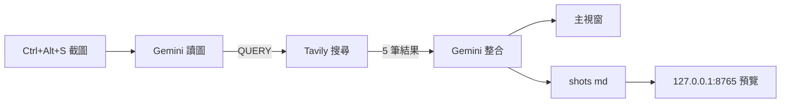

# 截圖問答工具（Gemini Vision + Tavily）

2026/10/28 課堂練習。`Ctrl+Alt+S` 框選畫面，交給 Gemini 讀圖、Tavily 查證，最後用繁體中文整合，結果寫成 Markdown 並在本機網站顯示。


## 功能

- 全域快捷鍵 `Ctrl+Alt+S`，或點系統匣圖示，兩種都能叫出截圖
- 全螢幕遮罩自由框選，放開滑鼠立刻裁切
- 彈窗輸入問題，右側 Debug 視窗同步顯示 API 走到第幾步與初步分析
- 「以圖搜圖」按鈕：SauceNAO、Google 圖片先跑，證據不足才補查 IQDB，插畫／立繪也能找到原始出處
- 問答結果輸出成 Markdown，本機網站每 2 秒自動更新
- 以圖搜圖結果在另一個頁面顯示，只留記憶體、不寫檔

## 套件與寫法

| 套件 | 版本 | 用途 |
| --- | --- | --- |
| `tkinter` | 3.13（內建） | 全螢幕遮罩、彈窗、Debug 視窗 |
| `Pillow` | 13.0.0 | 螢幕截取、調暗、縮圖 |
| `requests` | 2.34.2 | 直接打 Gemini / Tavily REST API |
| `pystray` | 0.19.5 | 系統匣圖示與右鍵選單 |
| `ctypes` | 內建 | 全域快捷鍵、DPI 宣告、單一實例 |

沒有用 PyQt6。Qt6 的 wheel 是 78 MB，這台機器實測下載到 4.2 MB 就 DNS 失敗重試五次，而 tkinter 方案額外下載量是 0（Pillow 與 requests 本來就裝好了）。

```text
PyQt6 + Qt6    84.8 MB  [████████████████████████] 100.0%
pystray         0.05 MB [▏                       ]   0.1%
```

### 幾個實作選擇

- **遮罩**：不用 alpha 合成，改成「整張截圖調暗 45% 當底圖，拖曳時把原圖的選取區貼回上層」。視覺上就是半透明遮罩，而且裁切時直接從原圖取，像素無損。
- **DPI**：開頭呼叫 `SetProcessDpiAwareness(2)`，否則 125% 縮放時框選座標與實際截圖會錯位。
- **執行緒**：API 呼叫在背景 thread，結果一律用 `self.after(0, ...)` 丟回 Tk 主執行緒，不跨執行緒碰 widget。
- **快捷鍵**：`RegisterHotKey(hWnd=None, ...)` 是綁「呼叫它的執行緒」的訊息佇列，所以註冊和 `GetMessageW` 必須在同一個執行緒；分開寫會收不到 `WM_HOTKEY`。
- **pythonw 陷阱**：用 `pythonw.exe` 啟動時 `sys.stderr` 是 `None`，`SimpleHTTPRequestHandler.log_message` 會嘗試寫入而拋錯，連線在送標頭前就斷掉，瀏覽器只看到 `ERR_EMPTY_RESPONSE`。解法是把 `log_message` 覆寫成空方法。

## 連接到 Gemini、OpenRouter 與 Tavily

金鑰全部放環境變數，不寫進程式碼。預設走 Gemini 官方端點；只要設了 `OPENROUTER_API_KEY`，程式啟動時就自動改走 OpenRouter，不用改任何一行。

| 變數 | 用途 |
| --- | --- |
| `GEMINI_API_KEY` | Gemini 官方端點，放在 `x-goog-api-key` header |
| `OPENROUTER_API_KEY` | 有設就用 OpenRouter，放在 `Authorization: Bearer` |
| `TAVILY_API_KEY` | 網路搜尋，放在 `Authorization: Bearer` |
| `GEMINI_MODEL` | 選填，預設 `gemini-3-flash-preview` |
| `OPENROUTER_MODEL` | 選填，預設 `google/gemini-3-flash-preview` |

```python
r = requests.post(
    f"https://generativelanguage.googleapis.com/v1beta/models/{MODEL}:generateContent",
    headers={"x-goog-api-key": os.environ["GEMINI_API_KEY"]},
    json={"contents": [{"parts": parts}]}, timeout=120)

r = requests.post(
    "https://openrouter.ai/api/v1/chat/completions",
    headers={"Authorization": f"Bearer {os.environ['OPENROUTER_API_KEY']}"},
    json={"model": MODEL, "max_tokens": 3000,
          "messages": [{"role": "user", "content": content}]}, timeout=120)

r = requests.post(
    "https://api.tavily.com/search",
    headers={"Authorization": f"Bearer {os.environ['TAVILY_API_KEY']}"},
    json={"query": query, "search_depth": "basic", "max_results": 5}, timeout=60)
```

兩家模型的輸入格式不同，內部統一用 Gemini 的 `parts`，呼叫前才轉成 OpenRouter 的 `content`：文字轉 `{"type": "text"}`，圖片轉 `{"type": "image_url", "image_url": {"url": "data:image/png;base64,..."}}`。回覆則分別取 `candidates[0].content.parts` 與 `choices[0].message.content`。

`max_tokens` 要設，不能留預設。OpenRouter 會用模型的預設上限（65536）去試算餘額，額度不夠就直接回 402，即使實際只會用掉幾百個 token。

金鑰不走 URL 查詢參數，因為 `raise_for_status()` 會把整串網址印進錯誤訊息，等於把 key 印出來。

## Tavily 的角色

Tavily 不讀圖，它只負責「拿 Gemini 想出來的那組關鍵字去查資料」，回傳標題、網址、摘要。真正做判斷的是第二次 Gemini。



這樣切的理由：模型自己講的內容無法查證，搜尋結果又沒有看過圖。拆成兩段後，第一段只描述圖片看到什麼、哪裡需要查，第二段拿搜尋結果回來對照，衝突的地方要明講，來源網址也一併附上。

## 三個步驟

| 步驟 | 呼叫 | 輸入 | 產出 |
| ---: | --- | --- | --- |
| 1 | Gemini vision | 截圖 + 使用者問題 + `PROMPT_PLAN` | 思考、初步回答、`QUERY:` 一行 |
| 2 | Tavily | 步驟 1 的 `QUERY` | 5 筆搜尋結果 |
| 3 | Gemini | 問題 + 初步分析 + 搜尋結果 + `PROMPT_FINAL` | 繁體中文整合回答 |

兩次 Gemini、一次 Tavily，順序固定，Debug 視窗就照這個順序顯示 `1/3`、`2/3`、`3/3`。

實際使用的兩段 prompt：

```text
你是截圖分析助理。請依序完成：
1. 思考：判斷圖片內容與使用者真正想解決的問題，指出需要上網查證的關鍵事實。
2. 初步回答：只寫圖片本身能確認的內容，不確定的地方標為（需查證）。
3. 搜尋：給出一組最適合查證的關鍵字，專有名詞請用原文。
全部使用繁體中文。最後一行固定格式：QUERY: <關鍵字>
```

```text
以下是你剛才對截圖的初步分析與網路搜尋結果。請整合成最終答案：
- 使用繁體中文（台灣用語），先給結論，再列重點。
- 只採用搜尋結果中確實存在的資訊，並在句子後標註來源網址。
- 若搜尋結果推翻或補充了初步分析，請明確說明差異。
- 不要臆測搜尋結果未提及的背景或原因。
- 精簡，不要整段貼上原始搜尋片段。
```

## 以圖搜圖：四個步驟

按「以圖搜圖」走另一條流程。插畫、立繪、遊戲 CG 這種圖，用文字關鍵字去猜出處幾乎不會準，必須讓引擎直接比對像素，所以先讓 Gemini 讀圖抓線索，再交給三家反向圖片搜尋。

| 步驟 | 呼叫 | 輸入 | 產出 |
| ---: | --- | --- | --- |
| 1 | Gemini vision ＋ SauceNAO / Google | 截圖 + `PROMPT_LOOK`，兩邊同時跑 | 內容與線索、`QUERY:`、SauceNAO 相似度、Google 結果頁 |
| 2 | IQDB（必要時才查） | 同一張圖 | SauceNAO 最高相似度低於 80% 才補查 |
| 3 | Gemini | 原圖 + 初步判讀 + 比對結果（都沒命中時改用 Tavily） | 判定與證據 |
| 4 | 本機輸出 | 判定 + 比對表格 | `shots/*.md` 與瀏覽器預覽 |

第 1 步的 Gemini 讀圖與兩家引擎上傳是並行的，誰先回來都不影響；第 2 步的 IQDB 只在 SauceNAO 信心不足時才查，因為它的佇列最慢卻最少用得上。

三家分工：

| 引擎 | 強項 | 限制 |
| --- | --- | --- |
| SauceNAO | Pixiv、Twitter、Danbooru 插畫，附繪師／作品／角色欄位 | 低相似度結果要自己過濾 |
| IQDB | booru 站（Danbooru / yande.re / Konachan…） | 佇列慢，忙的時候會回空頁 |
| Google 圖片 | 涵蓋面最廣，照片、商品、截圖都吃 | 回傳的是結果頁網址，內容由 JS 產生，抓不到 |

上傳前會先把裁切圖縮到 1500px、轉 JPEG 88%，避免大圖上傳被擋。SauceNAO 與 Google 一起跑，IQDB 視情況補上；任一家失敗只記在「未取得」，不中斷流程。Google 的結果頁會自動在瀏覽器打開，連結也寫進 md。

`PROMPT_LOOK` 先產出「可辨識線索」（簽名、浮水印、帳號、遊戲 UI、畫風），這一步是關鍵：引擎回傳 40～50% 的雜訊時，靠這些線索才判斷得出哪一筆才是真的。

```text
你是看圖助手。先不要上網，只看這張圖，用繁體中文回答：
1. 內容：畫的是什麼（人物、場景、物件、畫風）。
2. 可辨識線索：畫面中的文字、簽名、浮水印、帳號、遊戲 UI、畫風特徵。
3. 候選來源：最可能的作品／角色／繪師，最多 3 個，各標信心（高／中／低）。
4. 最後一行固定格式：QUERY: <最適合查證的關鍵字，專有名詞用原文>
```

```text
你是以圖搜圖結果的判讀員。使用者給你一張截圖、看圖助手先前的初步判讀，
以及幾個反向圖片搜尋引擎的比對結果。請用繁體中文（台灣用語）輸出：
1. 結論：這是什麼作品、哪個角色、作者是誰，並說明把握程度。
2. 證據：哪個引擎、相似度幾 %、站點標題與來源連結。
3. 相似度低於 60% 的結果只能當線索，不能當結論；
   Google 圖片沒有相似度，只能當旁證；結果衝突時要指出來並說明哪個可信。
4. 完全查不到就寫「查無可靠來源」，不要硬猜。
精簡，不要整段貼上原始比對結果。
```

### 速度

同一張裁切圖（用 md5 判斷）30 分鐘內重查會直接命中快取，連引擎都不用碰。實測：

| 情境 | Gemini 官方 | OpenRouter |
| --- | ---: | ---: |
| 首次，SauceNAO 高分（略過 IQDB） | 18.5 秒 | 7.9 秒 |
| 同一張圖重查（全快取） | 8.4 秒 | 4.0 秒 |
| 首次且需要補查 IQDB | 多 10～40 秒 | 多 10～40 秒 |

模型讀圖與引擎上傳並行，兩次模型呼叫（官方端點 5～10 秒、OpenRouter 2～4 秒）才是主要成本，搜尋本身不到 2 秒。

## 輸出形式

| 位置 | 內容 |
| --- | --- |
| 主視窗 | 結果 Markdown 原文（問答與以圖搜圖共用同一個框） |
| Debug 視窗 | `API 進度 n / 3`（問答）或 `n / 4`（以圖搜圖）、`QUERY`、初步分析全文 |
| `shots/shot-YYYYmmdd-HHMMSS.md` | 問答結果留一份 |
| `shots/latest.md` | 最新的問答結果，網站首頁讀這個 |
| `http://127.0.0.1:8765/` | 問答頁，`marked.js` 渲染 `latest.md` |
| `http://127.0.0.1:8765/rvs` | 以圖搜圖頁，渲染記憶體中的結果，**不寫檔** |

Markdown 長這樣：

```markdown
# 截圖分析

**問題**：這張圖是什麼？

**搜尋關鍵字**：`Limbus Company Haute Couture King of Needleworks`

## 整合回答

（Gemini 整合後的繁體中文內容，句子後附來源）

## 來源

- [Haute Couture::Le Rouge King of Needleworks Heathcliff](https://limbuscompany.wiki.gg/wiki/...)
- [ProjectMoon Official YouTube](https://www.youtube.com/watch?v=...)
```

本機網站是 `http.server.ThreadingHTTPServer` 起在 `127.0.0.1`，只綁 loopback，不對外開放。前端只有一段 fetch + `setInterval`，所以分析完不用手動重整。網址固定 8765，被佔用會往後找 8766～8784。

`/` 和 `/rvs` 兩頁只差在資料來源：問答讀磁碟上的 `latest.md`，以圖搜圖讀記憶體裡的 `LIVE["rvs"]`，由 handler 直接回傳，所以不會在 `shots/` 留下任何檔案。兩頁右上角互有連結，各自每 2 秒重新抓一次。想留下某次結果就自己從主視窗複製。

## 專案結構

```text
main.py            全部程式（約 700 行）
app.ico            系統匣與捷徑圖示，程式產生
requirements.txt   三個外部套件
shots/             執行後產生：index.html、latest.md、問答歷史 md（以圖搜圖不寫檔）
```

## 執行

```powershell
pip install Pillow requests pystray

# 走 Gemini 官方端點
$env:GEMINI_API_KEY=[Environment]::GetEnvironmentVariable('GEMINI_API_KEY','User')

# 或走 OpenRouter（有設這把就自動改用它，不必動程式）
$env:OPENROUTER_API_KEY=[Environment]::GetEnvironmentVariable('OPENROUTER_API_KEY','User')

$env:TAVILY_API_KEY=[Environment]::GetEnvironmentVariable('TAVILY_API_KEY','User')

python main.py
```

不想要黑色終端機視窗就用 `pythonw main.py`，或跑一次 `Screenshot Q&A.lnk`（用 `pythonw` + `app.ico`）。程式有做單一實例（具名 mutex），重複點擊不會出現第二個托盤圖示。

日常操作：`Ctrl+Alt+S` 截圖 → 輸入問題 → Enter → 看主視窗或瀏覽器。要找出處就按「以圖搜圖」（約 10～70 秒，IQDB 排隊時較久）。

## 備註

- 預設走 Gemini 官方端點（`GEMINI_MODEL`，預設 `gemini-3-flash-preview`）；設了 `OPENROUTER_API_KEY` 就改走 OpenRouter（`OPENROUTER_MODEL`，預設 `google/gemini-3-flash-preview`）。3.x 模型會在回覆中夾帶 `thought` 片段，取文字時會過濾掉。
- 截圖只存在記憶體，不落地；寫到磁碟的只有 Markdown。
- `marked.js` 走 jsDelivr CDN，第一次載入需要網路，之後瀏覽器會快取。要完全離線得把檔案放進 `shots/` 改相對路徑。
- Debug 視窗是主視窗的子視窗，關掉主視窗會一起關；它仍會佔一個工作列按鈕。
- IQDB 佇列較慢（實測 10～40 秒，最久 129 秒）且忙的時候會回空白頁，所以只在 SauceNAO 低於 80% 時才補查，並用執行緒硬性上限 12 秒，失敗只記在「未取得」。
